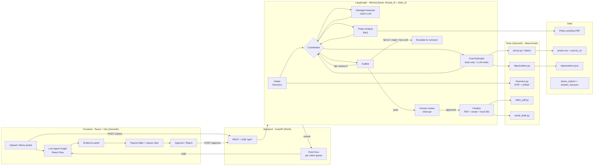

# ClaimMate — Architecture & Build Plan

**AgentOps 2026 · Team Dent Detectives (HX-B7Y5) · Track 01: Multi-agent systems**
Hackathon window: **10:00 – 17:00 IST, 24 Oct 2026** (7 hours)

| Who | Role | Owns |
|---|---|---|
| **Rohit** (`rohit-nandagopal`) | **A — Agents & backend** | `backend/agents`, `backend/llm`, `backend/rag`, `backend/app` (FastAPI) |
| **Samarth** (`SamarthKulkarnigit`) | **B — Data, tools, UI** | `data/`, `backend/tools`, `frontend/` |

> Rule: nothing is pre-built. Before 10:00 we only set up tools, keys, and collect source links.

---

## 1. What changed after evaluator feedback

| Feedback | Fix |
|---|---|
| Cost from photos is unreliable; no price / depreciation source | Vision only outputs **part + severity + repair/replace** (a classification). Rupees come from a **price table with a source URL per row** (Maruti Genuine Parts). Depreciation is a **fixed-rule function using the IRDAI/IMT schedule** printed in the standard Own Damage policy wording. Payout shown as a **low–high range**, always labelled *estimate*. Stretch: upload a **garage quote** and audit it line-by-line. |
| Standard pipeline; the Auditor adds value | The **Auditor is the star**: 6 tool-backed checks, a visible **send-back loop**, retry counter, and **escalation to a human surveyor**. |
| Very short deck, stray note | Remove slide-1 note & "IF APPLICABLE" label; add Architecture, Data Sources, and **Measured Results** slides. |

---

## 2. Architecture



### Models (Ollama Cloud, `https://ollama.com/api/chat`, key in `.env`)

| Use | Primary | Fallback |
|---|---|---|
| Vision (Damage Assessor, plate read) | **to confirm by test** — try `gemma4:31b`, `mistral-large-3:675b`, `kimi-k3` | next one that passes the image test |
| Reasoning / JSON (Policy, Auditor, Coordinator notes) | `gpt-oss:120b` ✅ tested | `deepseek-v4.1-flash` |
| Fast / cheap | `gpt-oss:20b` | `glm-5.3-flash` |

All LLM calls go through **one client** with: `format: "json"`, schema validation (pydantic), 2 retries, and an **on-disk cache** keyed by hash(model + prompt + image bytes). The cache is also the demo fallback.

Policy search uses **BM25 (`rank-bm25`) over clause-sized chunks** — no embedding API needed, and clause IDs stay exact.

---

## 3. Agent design

| Agent | Input | Does | Output to state |
|---|---|---|---|
| **Intake** (no LLM) | photos, docs | EXIF datetime, pHash, duplicate lookup | `photos[]` |
| **Coordinator** | whole state | Routes in code: next missing piece → that agent; Auditor's `send_back_to` → that agent with a hint; counts retries; writes a one-line rationale (LLM, fast model) for the UI | `next`, `retries`, event |
| **Damage Assessor** | photos (+ hint on re-check) | Per photo: parts, side, severity, repair/replace, material, confidence; reads number plate | `damages[]`, `plate_read` |
| **Policy Analyst** | damages, story | For each part: BM25 top-k clauses → LLM decides covered / not / partial with clause ID + quote | `coverage[]` |
| **Cost Estimator** | damages, coverage, vehicle | **Tools only for numbers**: price lookup, labour range, depreciation %, deductible. LLM only writes the plain-English line explanation | `estimate` |
| **Auditor** | everything | 6 checks below → `pass` / `fail(send_back_to, hint)` / `escalate(reason)` | `audit` |
| **Human review** | — | `interrupt()` — waits for user Approve/Reject | `decision` |
| **Finalize** | state | claim PDF, insurer email draft, POST to mock insurer | `outputs` |

### Auditor checks (the differentiator)

| # | Check | How | On failure |
|---|---|---|---|
| A1 | Photo date vs accident date & policy period | EXIF (tool) | escalate if outside policy; ask user if EXIF missing |
| A2 | Reused / duplicate photo | pHash distance vs `past_claims_hashes.json` (tool) | escalate (fraud flag) |
| A3 | Number plate matches RC | vision read vs `vehicle.reg_no` (string compare) | send back to Damage Assessor once, then escalate |
| A4 | Story vs damage location (front/rear/side) | LLM compares story to `damages[].side` | **send back to Damage Assessor with hint**; 2nd fail → escalate |
| A5 | Every estimate line has photo evidence + coverage decision | code | send back to Cost Estimator / Policy Analyst |
| A6 | Low confidence (<0.6) or major/structural damage | code | ask for clearer photo / escalate to surveyor |

Max **2 send-backs per claim**, then escalate. Every Auditor decision is an SSE event so the UI animates the loop.

---

## 4. Contracts (agree at 10:00, don't change after 10:30 without telling the other)

### 4.1 `ClaimState` (backend/agents/state.py)

```python
class ClaimState(TypedDict, total=False):
    claim_id: str
    story: str                       # user's one-liner
    accident_date: str               # ISO date
    vehicle: dict                    # {make, model, reg_no, cc, reg_date, age_months}
    policy: dict                     # {policy_no, start, end, idv, zero_dep: bool, voluntary_deductible: int, pdf_path}
    photos: list[dict]               # {id, path, exif_datetime, phash, duplicate_of}
    damages: list[dict]              # {part, side, severity, action, material, photo_ids, confidence}
    plate_read: str | None
    coverage: list[dict]             # {part, status: covered|not_covered|partial, clause_id, clause_quote, reason}
    estimate: dict                   # {lines:[...], totals:{gross_low, gross_high, depreciation, deductible, payable_low, payable_high}}
    audit: dict                      # {status: pass|fail|escalate, findings:[{check, ok, detail, send_back_to}]}
    retries: int
    next: str
    decision: str | None             # approved | rejected
    outputs: dict                    # {pdf_path, email_text, insurer_ref}
```

Estimate line: `{part, action, part_price, part_source_url, labour_low, labour_high, paint, material, dep_pct, dep_amount, payable_low, payable_high, clause_id, photo_ids, note}`

### 4.2 SSE event (`GET /api/claims/{id}/events`)

```json
{ "type": "agent_start | agent_end | message | send_back | escalate | interrupt | done | error",
  "agent": "coordinator | intake | damage | policy | cost | auditor | human | finalize",
  "ts": "2026-10-24T11:02:03Z",
  "text": "Auditor: story says rear-ended but damage is on the front",
  "data": { } }
```

### 4.3 REST API

| Method | Path | Body / Result |
|---|---|---|
| POST | `/api/claims` | multipart: `photos[]`, `story`, `accident_date`, `vehicle` (json), `policy` (json) → `{claim_id}` |
| POST | `/api/demo/{name}` | runs a demo claim from `data/demo_claims/{name}` → `{claim_id}` |
| GET | `/api/demo` | list demo claims |
| GET | `/api/claims/{id}/events` | SSE stream |
| GET | `/api/claims/{id}` | full `ClaimState` |
| POST | `/api/claims/{id}/approve` | `{approved: bool, note}` → resumes graph |
| GET | `/api/claims/{id}/pdf` | claim file PDF |
| POST | `/api/mock-insurer/claims` | returns fake reference no. |

### 4.4 Tool signatures (Samarth implements, Rohit calls — Rohit uses stubs until ready)

```python
# backend/tools/depreciation.py
def depreciation_pct(material: str, vehicle_age_months: int, zero_dep: bool) -> float
def compulsory_deductible(cc: int) -> int          # <=1500cc: 1000, >1500cc: 2000

# backend/tools/prices.py
def part_price(model: str, part: str) -> dict | None   # {price, source_url, checked_on}
def labour_range(part: str, action: str) -> tuple[int, int]

# backend/tools/forensics.py
def inspect_photo(path: str) -> dict               # {exif_datetime, has_exif, phash}
def find_duplicate(phash: str, max_distance: int = 6) -> str | None

# backend/tools/claim_pdf.py / email_draft.py
def build_claim_pdf(state: dict, out_path: str) -> str
def build_email(state: dict) -> str
```

### 4.5 Rules for numbers (fixed code, cite on the Data Sources slide)

Depreciation (standard Motor OD policy wording, IMT/GR.8):

- Rubber / nylon / plastic / tyres / tubes / batteries: **50%** · Fibreglass: **30%** · Glass: **0%**
- Paint: material taken as 25% of paint bill, 50% depreciation on that
- Metal and other parts, by vehicle age: ≤6 m **0%** · 6 m–1 y **5%** · 1–2 y **10%** · 2–3 y **15%** · 3–4 y **25%** · 4–5 y **35%** · 5–10 y **40%** · >10 y **50%**
- Zero-dep add-on → 0% on all parts

Compulsory deductible: **₹1,000** (≤1500 cc), **₹2,000** (>1500 cc), plus any voluntary deductible.

Line: `replace → part_price × (1 − dep) + labour` · `repair → labour + paint − paint dep`. Range comes from labour low/high. Payable = Σ lines − deductibles.

---

## 5. Repo layout

```
ClaimMate/
├─ backend/
│  ├─ app/            main.py (FastAPI), events.py (SSE bus), demo.py        [Rohit]
│  ├─ agents/         state.py, graph.py, coordinator.py, damage.py,
│  │                  policy.py, cost.py, auditor.py, finalize.py            [Rohit]
│  ├─ llm/            ollama_client.py (json, retry, cache)                  [Rohit]
│  ├─ rag/            ingest.py (PDF → clause chunks), search.py (BM25)      [Rohit]
│  ├─ tools/          depreciation.py, prices.py, forensics.py,
│  │                  claim_pdf.py, email_draft.py                           [Samarth]
│  ├─ tests/          test_depreciation.py, test_tools.py, test_graph.py
│  └─ requirements.txt
├─ data/                                                                     [Samarth]
│  ├─ policy/standard_od_policy.pdf
│  ├─ prices.csv      model,part,material,price,source_url,checked_on
│  ├─ labour.json     {part: {repair:[lo,hi], replace:[lo,hi], paint:[lo,hi]}}
│  ├─ depreciation.json
│  ├─ past_claims_hashes.json
│  ├─ demo_claims/<name>/{claim.json, photos/*.jpg}
│  └─ answer_key.json
├─ frontend/          Vite + React + TS + React Flow                         [Samarth]
├─ scripts/eval.py    runs all test claims vs answer_key → accuracy table    [Rohit]
├─ cache/             (gitignored) LLM responses
├─ .env               (gitignored) OLLAMA_API_KEY=...
└─ docs/PLAN.md
```

Python deps: `fastapi uvicorn[standard] sse-starlette python-multipart langgraph httpx python-dotenv pydantic pypdf rank-bm25 pillow imagehash reportlab pytest`
Frontend deps: `react react-dom @xyflow/react` (+ Tailwind optional)

---

## 6. Demo & test claims

**3 demo claims (must work flawlessly)**

| Name | Setup | Expected |
|---|---|---|
| `clean_swift_front` | Swift, 2.5 yrs old, front bumper + headlamp, story "hit a pole while parking" | All covered, Auditor passes first time, payout range with clause cites → approve → PDF |
| `partial_baleno_rear` | Baleno, rear bumper + tail lamp + "engine noise since accident" | Bumper/lamp covered; engine noise **not covered** (mechanical breakdown exclusion) |
| `mismatch_front_rear` | Story "I was rear-ended", photos show **front** damage | Auditor A4 fails → send back to Damage Assessor → still mismatch → **escalate to surveyor** |

**7 more for evaluation (10 total)**: duplicate photo (A2), EXIF date before policy start (A1), plate mismatch (A3), blurry photo (A6 → ask re-upload), zero-dep add-on (0% dep), 6-year-old car (40% metal dep), windshield-only (glass 0%).

`answer_key.json` per claim: covered parts, not-covered parts, expected audit outcome. `scripts/eval.py` prints the agreement %. **That number goes on the Results slide** (target ≥80%).

---

## 7. Timeline (10:00 – 17:00)

| Time | Rohit (A) | Samarth (B) | Checkpoint |
|---|---|---|---|
| **10:00–10:30** | Both: create skeleton, freeze contracts (§4), `requirements.txt`, Vite app | ← same | ✅ skeleton pushed |
| **10:30–11:30** | `ollama_client.py` (json+retry+cache) · vision test · `rag/ingest+search` on policy PDF | `depreciation.py` + tests · `prices.csv` (2 models × ~10 parts) · `labour.json` | |
| **11:30–12:30** | `state.py`, `graph.py` with Intake → Damage → Policy → Cost (tool stubs) → Auditor → interrupt | `forensics.py` (EXIF, pHash) · demo claim folders + photos · start Vite UI with **fake SSE events** | ✅ 12:30 graph runs in terminal on `clean_swift_front` |
| **12:30–13:00** | FastAPI: `/claims`, `/demo`, SSE bus, `/approve` | UI: upload/demo picker + live agent graph | lunch in shifts |
| **13:00–13:30** | **INTEGRATION 1**: real tools replace stubs, UI hits real API | ← same | ✅ clean claim end-to-end in browser |
| **13:30–14:30** | Auditor: all 6 checks, send-back loop, retry cap, escalate path | Payout table with clause cites + photo links · evidence panel with damage tags | |
| **14:30–15:30** | Coordinator rationale messages · `finalize` (PDF, email, mock insurer) wiring · hardening | `claim_pdf.py`, `email_draft.py` · approve flow · escalation screen · polish | ✅ 15:30 all 3 demo claims pass in UI |
| **15:30–16:15** | `scripts/eval.py` on 10 claims · warm the cache for demo claims | Deck: fix stray note, add Architecture / Data Sources / Results slides | ✅ accuracy number |
| **16:15–17:00** | **FEATURE FREEZE** · record 2-min backup video · rehearse | ← same | 🎤 |

**Stretch (only if ahead at 15:30):** garage-quote upload → vision reads line items → Auditor flags lines with no matching photo evidence or not covered.

### Git workflow
- `main` = always demo-able. Each person works on `rohit/*` or `samarth/*` branches, merges to main at each checkpoint.
- Rohit only edits `backend/{app,agents,llm,rag}`, `scripts/`. Samarth only edits `backend/tools`, `data/`, `frontend/`. Contracts (§4) change only after telling the other.
- Commit small and often; pull before every checkpoint.

---

## 8. Risks & fallbacks

| Risk | Fallback |
|---|---|
| Ollama Cloud slow / rate-limited | On-disk cache; demo endpoints replay cached runs; switch to `*-flash` models |
| Vision model returns bad JSON | `format:"json"` + pydantic validation + 2 retries; then mark low confidence → Auditor A6 |
| Vision misses parts | Demo photos chosen for clear damage; user can confirm/edit detected parts in UI |
| Integration breaks late | Feature freeze at 16:15; backup video recorded |
| Personal data exposure | Mask reg/policy numbers in UI & PDF except last 4 chars; no data leaves except to LLM |

---

## 9. Sources (for the Data Sources slide)

- Depreciation schedule & exclusions: [Royal Sundaram Standalone Motor OD Policy wording, Rev 2023](https://my.royalsundaram.in/sites/default/files/2023-10/Standalone_Motor_Own_Damage_Policy_Private_Car_Rev2023.pdf)
- Compulsory deductible: [ICICI Lombard — compulsory vs voluntary deductible](https://www.icicilombard.com/blog/car-insurance/car/compulsory-vs-voluntary-deductible-in-car-insurance)
- Parts prices: [Maruti Suzuki Genuine Parts](https://www.marutisuzuki.com/genuine-parts/head-lamp-assembly-right/35100m66t11) (one URL per row in `prices.csv`)
- Models: [Ollama Cloud docs](https://docs.ollama.com/cloud)
